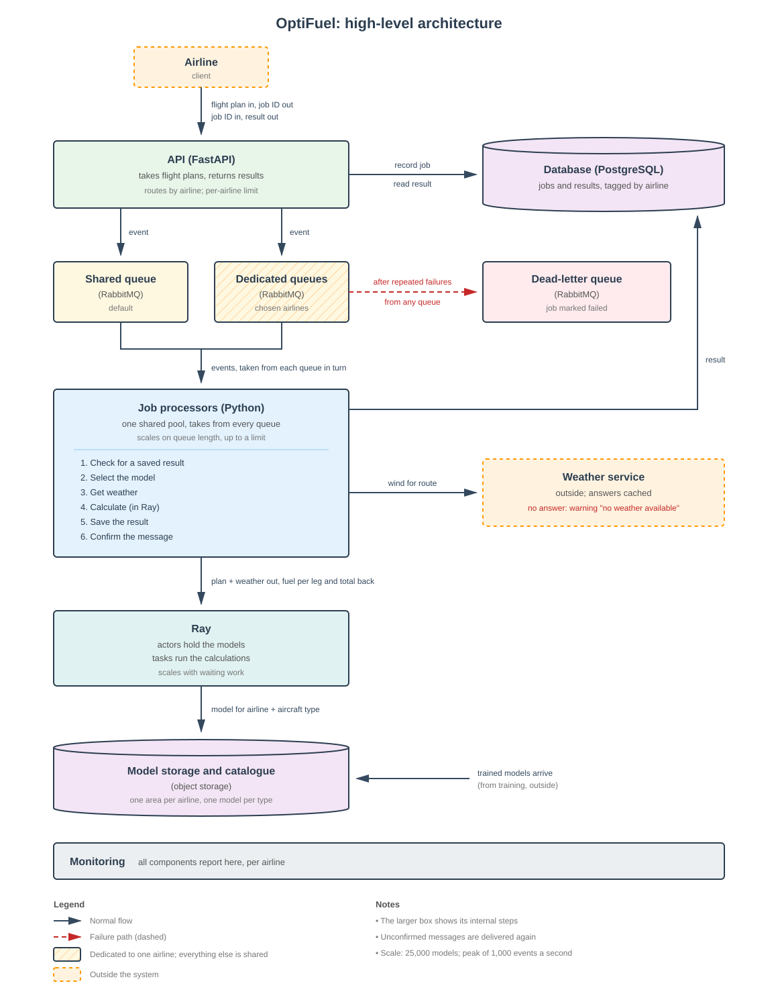

# **OptiFuel**

OptiFuel is a proof of concept for a FastAPI service that estimates the fuel a flight will burn. An airline submits a flight plan and receives a job ID. The service works out the fuel for the route, using the airline's own model and the current wind, and saves the result against that job ID. It is event-driven, with one model per airline, and built so the parts that change in production can be swapped without touching the rest.

<br>

- [**Table of Contents:**](#table-of-contents)
  - [**Architecture**](#architecture)
  - [**Features**](#features)
  - [**Explanations**](#explanations)
  - [**Technologies**](#technologies)
  - [**Deployment**](#deployment)
  - [**Testing**](#testing)
  - [**Database Design**](#database-design)
  - [**Assumptions and stand-ins**](#assumptions-and-stand-ins)
  - [**Not built**](#not-built)
  - [**How it would grow**](#how-it-would-grow)

<br>

## Architecture:

This is the production design for OptiFuel. The code in this repository is a demo build for one section, "Job processors", built so it can be dropped into this design.



<br>

## Features:

**API**

- Three routes: submit a flight plan, fetch the result by job ID, and a health check. See location:

  ```
  src/job_processor/web
  ```
- Submit returns at once with a job ID and the status `pending`. The work happens after the reply. Fetch the result with the job ID and the airline's name in the `X-Airline` header. A job that belongs to another airline, or does not exist, gives 404.
- Submit the example flight plan:

  ```
  curl -X POST localhost:8000/v1/jobs -H 'Content-Type: application/json' -d @resources/examples/flight_plan.json
  ```

  ```
  {"job_id": "7b181556-db0d-44da-ad94-b9ce649820e0", "status": "pending"}
  ```
- Fetch the result, using the job ID from the reply:

  ```
  curl localhost:8000/v1/jobs/7b181556-db0d-44da-ad94-b9ce649820e0 -H 'X-Airline: ABC'
  ```

  ```
  {
    "job_id": "7b181556-db0d-44da-ad94-b9ce649820e0",
    "status": "completed",
    "airline": "ABC",
    "flight_id": 123,
    "aircraft_type": "B777",
    "registration": "ABC-123",
    "total_fuel_lb": 3179.2399455045597,
    "total_distance_nm": 72.28579260104055,
    "total_time_hours": 0.52987332425076,
    "warnings": [],
    "reason": null,
    "model_id": "abc-standin",
    "model_version": "1",
    "created_at": "2026-10-10T19:43:25.098581Z",
    "completed_at": "2026-10-10T19:43:25.103464Z"
  }
  ```
- FastAPI's generated documentation is at `/docs` when the service is running.

**Job statuses**

- `pending` - Accepted, not yet processed.
- `completed` - Processed. May carry warnings.
- `rejected` - The flight plan cannot be processed, and trying again will not help. A reason is saved.
- `failed` - Something went wrong on our side. A reason is saved.

**Configuration**

- Two sources, by one rule. A settings file holds lists and mappings that are the same in every environment. Environment variables hold secrets and anything that differs between environments. Secrets never go in a file in the repository. See location:

  ```
  config/service.toml
  src/job_processor/settings.py
  ```
- The settings file holds the speed unit, the enabled aircraft types, and the model file for each airline.
- The environment variables:

  | Variable                    | Purpose                              | Default                       |
  | --------------------------- | ------------------------------------ | ----------------------------- |
  | `CONFIG_PATH`             | Where the settings file is           | `config/service.toml`       |
  | `DATABASE_URL`            | Database address                     | `sqlite:///storage/jobs.db` |
  | `WEATHER_PROVIDER`        | `fake` or `http`                 | `fake`                      |
  | `WEATHER_API_URL`         | Weather service address              | none                          |
  | `WEATHER_API_KEY`         | Weather service credential. A secret | none                          |
  | `WEATHER_TIMEOUT_SECONDS` | How long to wait for weather         | `2.0`                       |
  | `FAKE_WEATHER`            | `no_wind`, `calm`, or `strong` | `no_wind`                   |
  | `LOG_LEVEL`               | Logging detail                       | `INFO`                      |

**Model per airline**

- Each airline has its own model file, found through the settings file. A model file holds parameters as JSON, never code, so loading one cannot run anything hidden in it. See location:
  ```
  resources/models/
  src/job_processor/data/model_store.py
  ```
- The loader checks that the file's airline matches the airline asking, so one airline can never be served another's model.
- A model is read once and kept in memory.

**Weather**

- One call per flight plan, for the position and altitude of the first route point, at the current time. The wind changes how long each leg takes, and so how much fuel it burns. See location:
  ```
  src/job_processor/data/weather.py
  ```
- If the weather service fails for any reason, the job is not rejected. It goes on with no wind, and the warning `no weather available` is added to the result.
- Try the three fake winds on the same flight plan and compare the fuel:
  ```
  FAKE_WEATHER=strong uv run uvicorn --factory job_processor.main:create_app
  ```

**Testing suite**

- Three tests through the real HTTP routes, each with its own empty database, plus one that checks the layer rules and one that races eight workers on the guarded save. To run them, use this command in the terminal:
  ```
  uv run pytest
  ```

**Docker**

- A two-stage image of 52 MB. The final stage holds the virtual environment, the settings file and the model files, and runs as a non-root user. No source code and no build tools. See location:
  ```
  Dockerfile
  ```

<br>

## Explanations:

These notes develop on the more interesting parts of the project

<br>

**Three layers**

- The package follows the web, service, data layering from "FastAPI: Modern Python Web Development" by Bill Lubanovic.

  - `web` is HTTP only. It checks the request shape and calls one service function per route.
  - `service` is the pipeline. Plain Python that knows nothing about FastAPI or the database.
  - `data` is everything outside the process: the database, the model files, the weather service.
- `web` may import `service`. `service` may import `data`. Nothing imports upward, and `web` never imports `data`. Database sessions and the table class never leave `data`. A test parses every file and checks these rules hold.

<br>

**The pipeline**

- The work done on one job, as four steps in a fixed order. See location:

  ```
  src/job_processor/service/pipeline.py
  ```

  1. Check allowed. Is the aircraft type enabled, and does the airline have a model? If not, the job is rejected with a reason.
  2. Load model. From the cache, or from the file on first use.
  3. Get weather. One call. On failure, no wind and a warning.
  4. Calculate. Turn route, wind and model into fuel.
- Steps 1 to 3 reach outside the process. Step 4 does not. In production the job processor would do steps 1 to 3 and hand step 4 to Ray, and the calculation function would move there unchanged.

<br>

**The message handler**

- One function, `handle_message`, in the service layer. It is what a queue consumer would call in production. In this demo, the submit route schedules it as a FastAPI background task. See location:

  ```
  src/job_processor/service/handler.py
  ```

  Noteworthy behaviour:

  - If the job is not `pending`, it stops. The same message delivered twice does the work once.
  - It catches every exception. A rejection becomes `rejected` with a reason. Anything else becomes `failed` with a reason. One bad job never breaks the process.
  - It saves the outcome through the guarded save, and logs if another worker got there first.

<br>

**The guarded save**

- The outcome is written with one conditional update: set the status and result where the job ID matches and the status is still `pending`. If no row changed, another worker already saved an outcome. The database decides who wins, so two workers can never both save. See location:
  ```
  src/job_processor/data/job_store.py
  ```
- A test runs eight threads against one job and exactly one succeeds.

<br>

**The calculation**

- One function, `calculate_fuel`, with no outside calls. It receives the flight plan, the wind, the model and the speed unit, and returns three totals. See location:

  ```
  src/job_processor/service/calculation.py
  ```

  Noteworthy steps:

  - `build_legs` cuts the route into legs. A route of N points gives N-1 legs. Each leg takes the average speed and altitude of its two end points, its great-circle distance, and its initial bearing.
  - `apply_wind` finds each leg's ground speed as airspeed minus headwind, and its time as distance divided by ground speed. If a ground speed is zero or less the job is rejected.
  - The model gives a fuel flow per leg, in pounds per hour.
  - `total` adds up fuel as fuel flow times time, plus distance and time, over the legs.
- The geometry is standard navigation maths from the `math` module: the haversine formula for distance, the initial bearing formula, and the headwind as wind speed times the cosine of the angle between the wind and the leg. The Earth is treated as a sphere of 3,440.065 nautical miles radius. See location:

  ```
  src/job_processor/service/geometry.py
  ```

<br>

**Model store**

- Every model type offers one operation, `predict_fuel_flow`, which takes the legs and returns a fuel flow per leg. Only one type exists, `constant`, and a new type is one class with the same operation.

<br>

**Weather clients**

- Two clients behind one interface: give me the wind for this position, altitude and time.
- The HTTP client calls `GET {WEATHER_API_URL}/wind` with a bearer token and a timeout, and turns any failure into one error the pipeline knows how to handle. The brief says only that such a service exists and needs credentials, so its request and reply shapes are assumed.

<br>

**create_app**

- Builds the app and the four shared parts: the config, the job store, the model store and the weather client. They are bundled in one frozen dataclass and attached to the app, so every route and the handler see the same objects, and tests can pass in a different weather client.
- The server is started with uvicorn's `--factory` flag, so importing the module opens no database.

<br>

## Technologies:

- **Python**
  - [Python 3.12.15](https://www.python.org/) - Used as base language.
  - [uv 0.13.0](https://docs.astral.sh/uv/) - Environment, lock file and build backend.
- **Web**
  - [FastAPI 0.143.0](https://fastapi.tiangolo.com/) - The web framework. Validates requests, generates the docs page, runs the background task.
  - [Uvicorn 0.54.0](https://www.uvicorn.org/) - The ASGI server.
  - [Pydantic 2.14.0](https://docs.pydantic.dev/) - Data shapes and validation.
  - [pydantic-settings 2.15.0](https://docs.pydantic.dev/latest/concepts/pydantic_settings/) - Environment variables with defaults.
- **Data**
  - [SQLAlchemy 2.1.4](https://www.sqlalchemy.org/) - Database access.
  - [SQLite 3.46](https://www.sqlite.org/index.html) - For the demo database, provided by Python.
  - [httpx 0.28.1](https://www.python-httpx.org/) - HTTP client for the weather service.
- **Testing and quality**
  - [pytest 9.1.1](https://docs.pytest.org/) - Test runner.
  - [httpx2 2.13.1](https://pypi.org/project/httpx2/) - Required by FastAPI's test client.
  - [ruff 0.17.0](https://docs.astral.sh/ruff/) - Formatter and linter.
  - [mypy 2.4.0](https://mypy-lang.org/) - Type checker, in strict mode.
- **Docker**
  - [Docker 27.4.0](https://www.docker.com/) - Platform designed to help build, share, and run container applications.

<br>

## Deployment:

### Local Deployment:

Please note - in order to run this project locally on your own system, you will need the following installed:

- [uv](https://docs.astral.sh/uv/getting-started/installation/) to manage the environment. It installs Python 3.12 itself if needed.
- [Git](https://git-scm.com/book/en/v2/Getting-Started-Installing-Git) for version control.

1. Clone the repository and move into it:

   ```
   git clone https://github.com/isntlee/OptiFuel.git
   cd OptiFuel
   ```
2. Install the environment, including Python 3.12 if it is missing:

   ```
   uv sync
   ```
3. Run the service:

   ```
   uv run uvicorn --factory job_processor.main:create_app
   ```
4. The service listens on `localhost:8000`. The SQLite database is created at `storage/jobs.db` on first start. The documentation page is at `localhost:8000/docs`.
5. To use a real weather service, set the environment variables before starting:

   ```
   WEATHER_PROVIDER=http WEATHER_API_URL=https://weather.example WEATHER_API_KEY=your-key uv run uvicorn --factory job_processor.main:create_app
   ```

<br>

### Dockerize Application:

Please note - in order to run this container on your system, you will need Docker installed.

- [Docker](https://www.docker.com/) - to build and run this containerized application, add these commands to your terminal:

1. To build the image:
   ```
   docker build -t job-processor .
   ```
2. To run the container on port 8000:
   ```
   docker run --rm -p 8000:8000 job-processor
   ```
3. Environment variables are passed with `-e`, for example:
   ```
   docker run --rm -p 8000:8000 -e FAKE_WEATHER=strong job-processor
   ```
4. The database lives inside the container and is lost when it stops. In production `DATABASE_URL` points at PostgreSQL.

<br>

## Testing:

1. Run the tests:

   ```
   uv run pytest
   ```
2. Three tests go through the real HTTP routes with FastAPI's test client. Each builds its own app with an empty SQLite database in a temporary folder.

   - A normal flight plan gives the right fuel total. One degree east along the equator at 240 km/h and no wind is 2,779.9 lb with the ABC stand-in model.
   - A disabled aircraft type is accepted with 202, then rejected with a reason naming the type.
   - A weather failure still gives a result, with the warning `no weather available`.

   Two more check claims made in the Explanations above:

   - Each layer imports only what the layer rules allow. The test parses every source file.
   - Only one of eight workers racing to save the same job succeeds.
3. Run the formatter, linter and type checker:

   ```
   uv run ruff format --check .
   uv run ruff check .
   uv run mypy
   ```

<br>

## Database Design:

- [SQLite](https://www.sqlite.org/index.html) - For the demo, through SQLAlchemy. Moving to PostgreSQL is a change of `DATABASE_URL`. The table is created at startup. No migration tool.

### Data Models:

**Jobs table**

A job and its result are the same row. Every read for a client is scoped by airline.

| Name           | Key in DB         | Type             | Notes                                            |
| -------------- | ----------------- | ---------------- | ------------------------------------------------ |
| Job ID         | job_id            | str              | Primary key. A UUID made by the service.         |
| Airline        | airline           | str              | On every row. Fetch requires it to match.        |
| Flight ID      | flight_id         | int              | Copied from the flight plan.                     |
| Aircraft type  | aircraft_type     | str              | Copied from the flight plan.                     |
| Registration   | registration      | str              | Copied from the flight plan. Not used otherwise. |
| Flight plan    | flight_plan       | JSON             | The submitted plan. Stored, not returned.        |
| Status         | status            | str              | pending, completed, rejected, failed.            |
| Reason         | reason            | str or null      | Set when rejected or failed.                     |
| Total fuel     | total_fuel_lb     | float or null    | Pounds. Empty until completed.                   |
| Total distance | total_distance_nm | float or null    | Nautical miles. Empty until completed.           |
| Total time     | total_time_hours  | float or null    | Hours. Empty until completed.                    |
| Warnings       | warnings          | JSON list        | May hold "no weather available".                 |
| Model ID       | model_id          | str or null      | Which model produced the result.                 |
| Model version  | model_version     | str or null      | Which version of it.                             |
| Created at     | created_at        | datetime         | UTC.                                             |
| Completed at   | completed_at      | datetime or null | UTC. Set by the guarded save.                    |

<br>

## Assumptions and stand-ins:

**Assumptions**

- The brief does not state the unit of speed in the flight plan. It is taken as km/h, and as airspeed. The unit is a setting and can be changed to knots or m/s.
- Altitude is in feet.
- The flight plan has no departure time, so weather is asked for the current time.
- One weather call per flight plan, for the first route point. The one wind is applied to every leg, each with its own bearing. A real system would ask per leg and for the departure time.
- The Earth is a sphere. The error from ignoring its true shape is typically up to 0.3 percent, and at most about 0.55 percent.

**Stand-ins**

- The two models are placeholders. Each returns one fixed fuel flow whatever the speed and altitude: 6,000 lb per hour for ABC and 5,000 for XYZ. They exist so it can be seen that the right model is picked.
- Weather is a fake by default, with three settings: `no_wind`, `calm` (10 knots from the east) and `strong` (40 knots from the east). The HTTP client is written against an assumed service.
- Background work in the same process stands in for a queue. It is not durable: a job accepted just before the process stops is lost. In production a durable queue sits between submit and the handler, and the handler is what the queue consumer calls.
- The `X-Airline` header stands in for a login token.
- Rejecting a disabled aircraft type or an unknown airline inside the job processor is a demo shortcut. The production design in the diagram handles this outside the worker, so its step list does not show it.

<br>

## Not built:

- A real queue. Login. Kubernetes files. Real models. Retries. Async code. A migration tool.

<br>

## How it would grow:

| To add                              | Change                                                                                                                                                                                                                    |
| ----------------------------------- | ------------------------------------------------------------------------------------------------------------------------------------------------------------------------------------------------------------------------- |
| A filter or any new processing step | Write one function. Add it to the calculation if it is pure maths, or to the pipeline if it calls something outside. Other steps are untouched. Example: a step that removes repeated route points before legs are built. |
| A new kind of model                 | Write one model type with the same operation. Register its type name.                                                                                                                                                     |
| A different weather provider        | Write one client with the same interface. Select it in settings.                                                                                                                                                          |
| PostgreSQL                          | Change`DATABASE_URL`. Only the job store touches the database.                                                                                                                                                          |
| A real queue                        | Write a consumer that calls the existing message handler. The pipeline is untouched.                                                                                                                                      |
| Parallel work with Ray              | Run the calculation function in Ray, where actors hold the models. The handler, the check and the weather call stay in the job processor.                                                                                 |
| Many workers at once                | Nothing. The guarded save already makes this safe.                                                                                                                                                                        |
| Async                               | Change the routes, the handler, the weather client and the job store. The calculation is untouched.                                                                                                                       |

<br>
